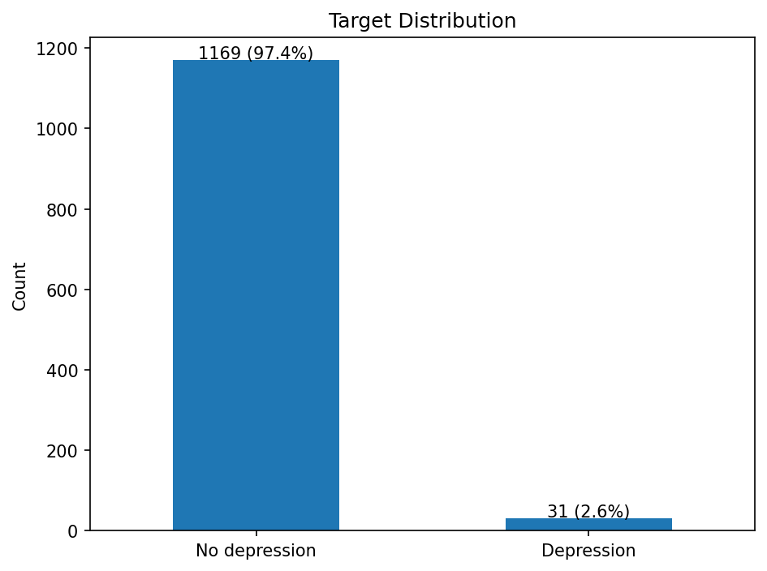
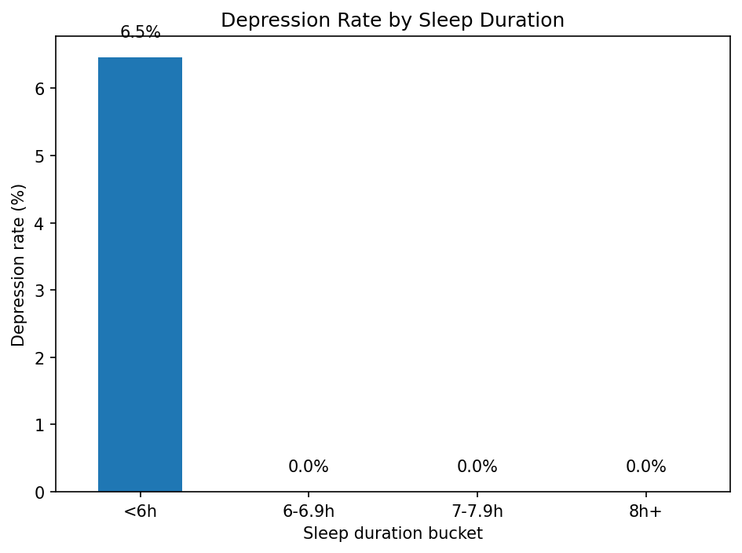
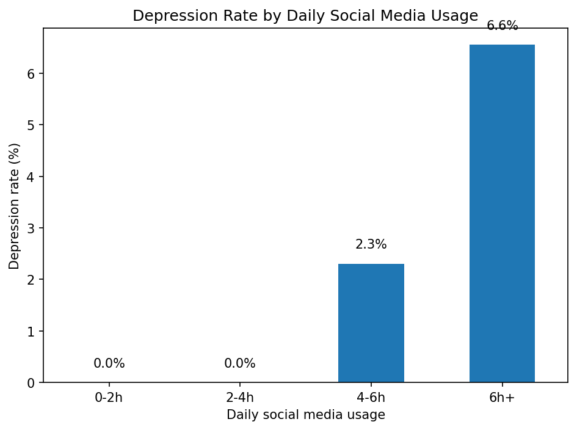
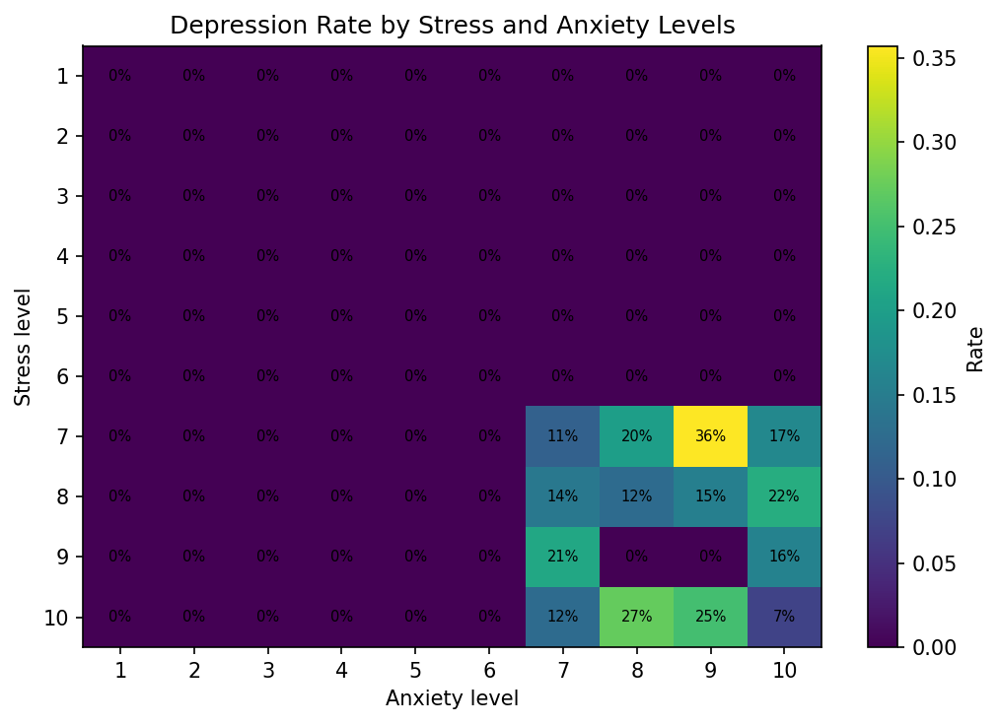
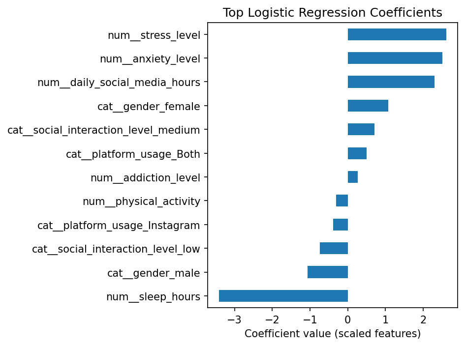

# Teen Mental Health Analysis

Data analysis project exploring behavioral factors associated with teen depression using Python for analysis.

## Project objective

The goal of this project is to identify how sleep, social media usage, stress, and anxiety relate to the likelihood of depression in a teen mental health dataset, then translate those findings into an executive-friendly dashboard design.

## Dataset

- Source file: `Teen_Mental_Health_Dataset.csv`
- Rows: 1,200
- Columns: 13
- Target variable: `depression_label`

## What this project includes

- Exploratory data analysis notebook
- Reproducible Python scripts for data prep and modeling
- Exported PNG charts for GitHub-ready storytelling
- Processed dataset for Power BI import
- Power BI build guide, DAX measures, and theme file

## Key findings

- The depression-positive share is **2.6%**, so the target is highly imbalanced.
- Teens sleeping under 6 hours have a depression rate of **6.5%**.
- Teens using social media for 5 or more hours per day have a depression rate of **5.8%**.
- Stress and anxiety show the strongest association with higher-risk outcomes.
- The labels in this dataset appear to be highly structured. In fact, a simple rule using sleep, social media, stress, and anxiety reproduces the target perfectly in this dataset. That makes this project useful for demonstrating analysis workflow and dashboard design, but any real-world interpretation should be cautious.

## Repository structure

```text
teen_mental_health_project_option_a_full/
├── data/
│   ├── raw/
│   └── processed/
├── notebooks/
├── powerbi/
├── reports/
│   ├── dashboard_screenshots/
│   └── figures/
├── src/
├── .gitignore
├── LICENSE
├── README.md
└── requirements.txt
```

## Visual summary

### 1) Target distribution


### 2) Sleep duration and depression


### 3) Social media usage and depression


### 4) Combined stress and anxiety pattern


### 5) Interpretable model coefficients


## Modeling summary

A class-weighted logistic regression was used as an interpretable baseline.

- ROC AUC: **0.985**
- Average precision: **0.702**

Because the target is highly imbalanced and structurally generated, these metrics should be interpreted as a property of this dataset rather than a claim of real-world predictive performance.


## Limitations

- The dataset is synthetic or at least strongly rule-driven.
- The target is very imbalanced.
- Findings should be presented as a dataset case study, not as clinical evidence.

